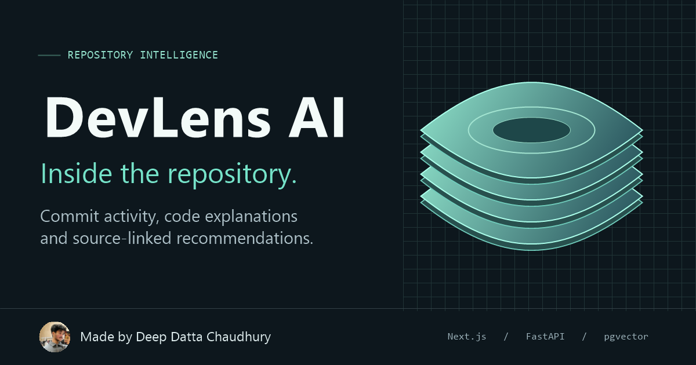

# DevLens AI



DevLens AI is a public GitHub repository analyzer by **Deep Datta Chaudhury**. Explore commit activity, language composition, project structure, documentation and maintenance evidence. Open a commit or file to verify a finding. The developer profile includes Deep’s original portrait.

## Open the demo

[Launch DevLens AI](https://deepgotnochill-cmd.github.io/DevLens-AI/) to analyze a public repository in your browser. This edition uses anonymous GitHub REST requests and requires no API key. Code explanations run in the self-hosted edition.

Download the project and open **DevLens-AI.html** in a desktop browser. The bundled React report works offline. Enter a public GitHub URL for a fresh report, or choose the Flask or C++ practice shortcut. Press **/** to focus the search field. Hover or keyboard-focus a point in the activity chart to read its date and count.

### Publish the dashboard on GitHub Pages

Place the contents of this folder at your repository root. In **Settings → Pages**, choose **GitHub Actions**. From **Actions**, run **Publish dashboard**. The workflow tests and builds the static dashboard and publishes it only when manually started. Its repository-relative assets support project URLs such as `https://USERNAME.github.io/REPOSITORY/`. The public demo uses GitHub’s anonymous API. For AI answers, run the full stack below.

Use **public/social-preview.png** as the GitHub social preview or upload it as media for the LinkedIn project.

## Run the full stack

Install Docker with Compose. From this directory, copy `.env.example` to `.env` and set `POSTGRES_PASSWORD` to a random URL-safe password. Add `OPENAI_API_KEY` to enable explanations. A read-only `GITHUB_TOKEN` increases the GitHub request quota. Use a token restricted to public repository data.

```sh
docker compose up --build
```

Visit **http://localhost:3000**. Nginx serves the Next.js static export and forwards `/api/` to FastAPI. PostgreSQL and the API are on the internal Compose network. Database initialization creates the vector extension and chunk table on first startup. For an existing database, apply `db/init.sql` with a role allowed to create extensions.

## Analyze a repository

1. Enter an HTTPS GitHub repository URL and select **Analyze**.
2. Use Overview for exact-source metrics, UTC commit samples and language-byte proportions.
3. Open File explorer or Documentation to inspect files at the sampled Git revision. Recommendations identify their file evidence and flag incomplete trees.
4. In Code explainer, choose a text file, ask a question and expand its cited excerpts.

The first screen shows a dated React repository snapshot. Its commit page and root tree are verified against the same revision. Under Analysis scope & sources, review the sample boundaries. Live analyses replace that snapshot only after the GitHub requests succeed.

## Architecture

| Layer | Implementation |
| --- | --- |
| Frontend | Next.js App Router, React, strict TypeScript, Tailwind CSS and dashboard styles |
| Repository service | FastAPI, Pydantic and HTTPX against GitHub REST |
| Retrieval | PostgreSQL 17 and pgvector, cosine distance within one file and revision |
| Models | OpenAI embeddings and chat completions, using server-side credentials |
| Static mode | Same TypeScript dashboard with anonymous browser-to-GitHub requests |

The renderer and analysis functions live in `src/`. The Next.js page loads their browser modules. `scripts/assets.mjs` uses Node’s TypeScript erasure to prepare those modules. The optional dependency-free static build ships the same screens and integrations.

## Evidence and limits

- Repository counts and language totals reflect GitHub at retrieval time. Open items include open issues and pull requests. Watchers means subscribers.
- Live history includes at most 100 default-branch commits. The chart counts retrieved commits per UTC day in a selectable window. A zero means zero in the sample. It cannot establish repository-wide inactivity.
- Tree reads are pinned to the sampled head, capped at 5,000 paths and marked partial when truncated. Empty repositories have no revision. File-presence rules recognize naming conventions and do not assess test coverage or documentation quality.
- The featured snapshot includes 30 commits and root-level paths. Source endpoint URLs are in `public/featured.json`.
- Successful reports are cached for five minutes with bounded process memory. Failed requests are retryable. A repository that becomes private may remain in the cache until expiry.
- AI sends the selected public file’s chunks and question to OpenAI. Code is retrieved as data and never executed. Chunk embeddings are stored by repository, revision, file and line span. Vector retrieval selects up to four excerpts. The API accepts citations only to retrieved spans. Model interpretation can still be wrong. Review the supplied excerpts.
- Supported UTF-8 source files are limited to 60 KB and 128 overlapping chunks. AI requests have per-process concurrency and request limits. Code explanations require a configured backend.

## Development

Use Node 22.14+ and Python 3.11+. Create a virtual environment and install the dependencies.

```sh
python -m pip install -r requirements.txt
python -m uvicorn api.main:app --reload --env-file .env
```

Set `NEXT_PUBLIC_API_URL=http://localhost:8000` in `.env.local` and run:

```sh
npm install
npm run dev
```

For retrieval during local development, also export `DATABASE_URL` for an initialized PostgreSQL instance. Configure `CORS_ORIGINS` as a comma-separated list of frontend origins. Next.js uses `NEXT_PUBLIC_API_URL` at build time. Leave it empty for anonymous GitHub analysis with AI disabled.

## Tests and builds

```sh
python -m unittest discover -s tests
npm test
npm run typecheck
npm run build
```

For a dependency-free static build with Node 22.14+, run `node scripts/assets.mjs --static` and serve the resulting `out` directory. This default static mode requires internet access to GitHub for new analyses.

## API

The Docker Compose gateway exposes the API at `http://localhost:3000/api`. Append the routes below to that base URL. For interactive documentation with Uvicorn running directly on port 8000, open `http://localhost:8000/docs`.

| Method and route | Payload | Result |
| --- | --- | --- |
| GET /health | — | Service status |
| POST /analyze | `{"url":"https://github.com/pallets/flask"}` | Typed repository report |
| POST /explain | Repository URL, revision SHA, indexed path and question | Explanation and cited excerpts |

Example analysis request:

```sh
curl -X POST http://localhost:3000/api/analyze -H "Content-Type: application/json" -d '{"url":"https://github.com/deepgotnochill-cmd/DevLens-AI"}'
```

For `POST /explain`, send `url`, `revision` (the full `head` from the analysis response), `path` (a returned source-file path), and `question`. A successful answer includes `sources` with the file path, line range, excerpt and GitHub link.

Keep `OPENAI_API_KEY`, the optional `GITHUB_TOKEN`, and database credentials in the backend environment. The Pages build reads public GitHub data directly. Its network requests are visible in browser developer tools and carry no private token.

FastAPI provides the full schemas at `/docs`. GitHub requests go only to the fixed REST host and reject redirects. Tokens remain on the server. For internet-facing AI deployments, place authentication, HTTPS and shared quotas at the ingress, set provider spending limits and schedule retention for older `code_chunks`. The bundled Compose configuration binds the web port to loopback.

## Private AI review on Render

[Start the Render deployment](https://render.com/deploy?repo=https://github.com/deepgotnochill-cmd/DevLens-AI). The blueprint deploys the Python API and PostgreSQL with pgvector in Singapore. Enter your own OpenAI key in Render's secret field. The hosted workspace uses the username **deep** and the generated **REVIEW_PASSWORD** from your service environment. Open the web service's HTTPS URL and sign in to analyze your repository and ask questions under Code explainer. Only the health check is public.

The free web service can sleep when idle and the free database expires after 30 days. Model calls use your provider account. Review plan details before enabling a paid service.

### Ask what could be improved

In the public dashboard, open **Recommendations → Prepare an AI review prompt** for a copyable prompt with revision-specific evidence. For a private model-generated answer, run this PowerShell example after the Render workspace is deployed. Replace the origin with the actual service URL. PowerShell prompts for the workspace password.

```powershell
$origin = 'https://YOUR-SERVICE.onrender.com'
$credential = Get-Credential -UserName deep -Message 'DevLens review workspace'
$headers = @{ Authorization = 'Basic ' + [Convert]::ToBase64String([Text.Encoding]::UTF8.GetBytes('deep:' + $credential.GetNetworkCredential().Password)) }
$url = 'https://github.com/deepgotnochill-cmd/DevLens-AI'
$report = Invoke-RestMethod "$origin/api/analyze" -Method Post -Headers $headers -ContentType 'application/json' -Body (@{url=$url} | ConvertTo-Json)
$body = @{url=$url; revision=$report.head; path='api/analyzer.py'; question='Suggest one improvement to maintainability supported by this file. Cite the exact lines, describe the impact, and give a regression test.'}
Invoke-RestMethod "$origin/api/explain" -Method Post -Headers $headers -ContentType 'application/json' -Body ($body | ConvertTo-Json) | ConvertTo-Json -Depth 8
```

## Author

[Deep Datta Chaudhury on GitHub](https://github.com/deepgotnochill-cmd)

